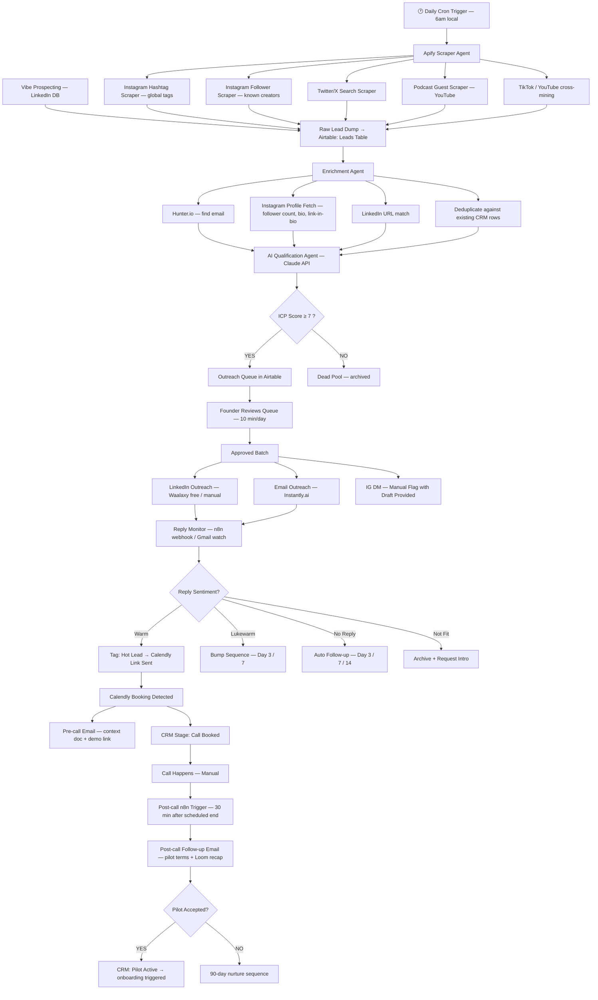

# DealDock — Automated Client Acquisition System

**Version:** 2.0  
**Date:** 2026-05-20  
**Goal:** Scrape → Enrich → Qualify → Contact → Follow-up → Track → Convert  
**Target:** 10 design partners in 30 days, minimum manual effort  
**Scope:** Global — India (primary), US, UK, Canada, Australia, Southeast Asia  

---

## System Overview

The system runs as a daily pipeline. Every 24 hours it sources new leads, enriches and scores them with AI, routes qualified leads into outreach sequences, and auto-updates the CRM as replies and bookings come in. The only human touchpoints are: (1) approving the day's outreach queue (~10 min), and (2) running the actual calls.

```
┌────────────────────────────────────────────────────────────────────┐
│                    DEALDOCK ACQUISITION ENGINE                     │
│                                                                    │
│  [Apify Scrapers] ──► [Enrichment Layer] ──► [AI Qualifier]       │
│         │                                          │               │
│         ▼                                          ▼               │
│  [Raw Lead DB]              ┌─────────────[Score ≥ 7?]            │
│                             │ YES                  │ NO            │
│                             ▼                      ▼               │
│                    [Outreach Queue]         [Dead Pool]            │
│                             │                                      │
│                    ┌────────┴────────┐                             │
│                    ▼                 ▼                             │
│             [LinkedIn Seq]    [Email Seq]    [IG: Manual]          │
│                    │                 │                             │
│                    └────────┬────────┘                             │
│                             ▼                                      │
│                    [Reply Detected]                                │
│                             │                                      │
│             ┌───────────────┼───────────────┐                      │
│             ▼               ▼               ▼                      │
│        [Warm Reply]   [Lukewarm]      [Not Fit]                    │
│             │               │               │                      │
│             ▼               ▼               ▼                      │
│      [Book Call]     [Follow-up]      [Archive]                    │
│             │                                                      │
│             ▼                                                      │
│    [Calendly Booked] ──► [Pre-call Email] ──► [CRM: Call Done]    │
│             │                                                      │
│             ▼                                                      │
│    [Post-call Follow-up] ──► [Pilot Active] ──► [Paying]          │
└────────────────────────────────────────────────────────────────────┘
```

---

## Mermaid Workflow Diagram



---

## Tool Stack

| Stage | Tool | Purpose | Cost |
|---|---|---|---|
| **Orchestration** | n8n (self-hosted or cloud) | Connects all tools, sequences, follow-up timers | $20/mo cloud or free self-hosted |
| **Scraping** | Apify | Instagram, LinkedIn, Twitter, YouTube scrapers | Pay-per-use ~$5–20/mo |
| **Email finding** | Hunter.io | Find professional email from name + domain | Free 25/mo |
| **Email enrichment** | Apollo.io | Additional enrichment + email verification | Free 50 exports/mo |
| **CRM** | Airtable | Lead database, pipeline, tracking sheet | Free tier |
| **AI Qualification** | Claude API (claude-sonnet-4-6) | ICP scoring, personalization | ~$0.01/lead |
| **Email Outreach** | n8n Gmail node (your own Gmail) | Sends sequences directly from your Gmail account | Free |
| **LinkedIn Outreach** | Manual + Waalaxy free tier | 80 connection requests/mo free; n8n drafts messages to Slack | Free |
| **Call Booking** | Calendly | Self-serve booking with lead data capture | Free tier |
| **Notifications** | Slack | Founder alerts — IG DM drafts, hot replies, follow-up reminders | Free |
| **Analytics** | Airtable views | Daily counter dashboard | Included |

**Total stack cost: ~$45–65/mo (n8n $20 + Apify ~$20 + Claude API ~$5–10). Zero paid outreach tools needed at pilot volume.**

> **Why not Instantly.ai / Expandi?**  
> At 10 design partners, you're sending ~15 outreach touches/day max. That's 5 min of manual LinkedIn + n8n auto-sending emails via your own Gmail. Paid outreach platforms earn their keep at 100+ sends/day. Spend that $136/mo on Apify credits or Claude API instead — the scraping and AI qualification are where the leverage is at this stage. Upgrade to paid outreach tools once you have 3–4 paying customers funding the system.

---

## Stage 1 — Lead Sourcing Agent

### What it does
Runs every day at 6am (founder's local time). Pulls raw leads from **two parallel channels**: (A) Apify scrapers for Instagram/Twitter/YouTube, and (B) Vibe Prospecting for LinkedIn-verified contacts with emails already attached. Together these cover both Instagram-native creators and professionally-positioned coaches globally.

### Channel A — Apify Scrapers (Instagram-native creators)

#### 1a. Instagram Hashtag Scraper
**Actor:** `apify/instagram-hashtag-scraper`  
**Run daily. Rotate 2 hashtags/day across two tracks:**

**India track:**
```
#cohortbasedlearning · #coursecreatorindia · #onlinecoachingindia
#reelsstrategy · #solopreneurindia · #digitalcoachindia
```
**Global track:**
```
#onlinecoach · #coursecreator · #businesscoach · #lifeCoach
#cohortbasedcourse · #digitalcourse · #onlinecourse · #creatoreconomy
#kajabi · #teachable · #thinkific · #skool
```
**Config:** (see `apify-configs/instagram-hashtag-scraper.json`)  
**Extract:** username, followers, bio, website URL, recent post captions  

#### 1b. Instagram Follower Scraper (high-signal)
**Actor:** `apify/instagram-followers-scraper`  
**Run 3x/week. Two target lists:**

**India targets:**
```
akshatsrivastava_ · ankurwarikoo · rajshamani · anushkarathod_ · sharanhegde · nikhilkamathofficial
```
**Global targets:**
```
amyporterfield · jameswendell · pat_flynn · marieforleo · brendon.burchard
```
**Config:** Followers with 20K–500K only (filter in n8n). See `apify-configs/instagram-follower-scraper.json`

#### 1c. Twitter/X Search Scraper
**Actor:** `apify/twitter-scraper`  
**India searches:**
```
india creator MRR -filter:replies min_faves:10
cohort india "₹" course
"build in public" india coach
"i make" "lakh" instagram
```
**Global searches:**
```
"sold out" cohort course min_faves:20
"course creator" MRR "$" -filter:replies
"online course" "students" launch min_faves:15
"coaching program" "DMs" overwhelmed
```

#### 1d. Podcast Guest Scraper
**Actor:** `apify/youtube-scraper` → target podcast channels  
**India channels:** Raj Shamani, Neon Show, Ranveer Show, Build with Aprameya  
**Global channels:** Online Marketing Made Easy (Amy Porterfield), Smart Passive Income (Pat Flynn), MarieTV, Course Creator Pro  
**Run weekly.** Extract episode guests → Google/LinkedIn lookup → push to Airtable

### Channel B — Vibe Prospecting (LinkedIn-verified, emails included)
**Run weekly (Monday mornings).** Search parameters already validated:

| Search | Filters | Results |
|---|---|---|
| India e-learning founders | website_keywords: "online course/cohort/coaching" + IN + 1-10 staff | ~33/run |
| Global e-learning CEOs | linkedin_category: e-learning/training + website_keywords + 1-10 staff + c-suite | ~50/run |
| Global coaches by title | job_title: business/life/online/digital coach + 1-10 staff | ~50/run |

**Enrich each batch** with `enrich-prospects-contacts` (email type only) before exporting to CSV → import to Airtable.

**Already exported Wave 1:**
- 🇮🇳 India coaching/e-learning: [33 leads](https://share.explorium.ai/fxk9uc)
- 🌍 Global e-learning CEOs: [50 leads](https://share.explorium.ai/n1xSAJ)
- 🌍 Global coaches by title: [31 leads](https://share.explorium.ai/KljBM6)

### n8n Flow: Sourcing
```
[Apify Webhook] 
  → [n8n: Parse actor output]
  → [n8n: Map fields to schema]
  → [n8n: Check Airtable — already exists?]
  → [Airtable: Create record if new]
  → [Slack: "X new leads sourced today"]
```

**Output schema per lead:**
```
ig_handle, ig_followers, ig_bio, ig_website, 
linkedin_url, twitter_handle, 
source, source_detail, date_sourced,
raw_bio_text, recent_post_sample
```

---

## Stage 2 — Data Enrichment Agent

### What it does
Runs at 7am IST on all new leads from Stage 1. Fetches additional signals needed for qualification.

### Enrichment Steps

#### 2a. Email Discovery
```
n8n HTTP node → Hunter.io API
Input: first_name + last_name + domain (extracted from ig_website)
Output: email, confidence score
```
If Hunter fails → try Apollo.io domain search → if still no email, flag `email_found: false`

#### 2b. Instagram Profile Deep Fetch
```
Apify actor: apify/instagram-profile-scraper
Input: ig_handle
Output: 
  - follower_count (precise)
  - following_count
  - posts_count
  - is_business_account
  - bio_links (all URLs in bio)
  - story_highlights (names/count)
  - recent_posts (last 9 captions)
  - recent_posts_avg_likes
  - is_verified
```

#### 2c. Bio Link Classifier
n8n HTTP → Fetch the URL in bio → check for signals:
- Contains "Stan Store" / "Exly" / "Graphy" / "Kajabi" / "Razorpay" / "UPI" → `has_product_page: true`
- Contains "Calendly" / "Topmate" / "Cal.com" → `has_booking: true`
- Linktree only → dig one level deeper and check destinations

#### 2d. Deduplication
```
n8n: Query Airtable for ig_handle
If exists → skip or update enrichment fields only
If new → create full record
```

---

## Stage 3 — AI Qualification Agent

### What it does
After enrichment, Claude API scores every new lead against the ICP. Runs at 8am IST.

### Prompt Template
```
You are a sales qualifier for DealDock, a B2B SaaS for Instagram-first creators and coaches.

ICP TARGET (global):
- Solo creator or tiny team (1–2 people) with 20K–500K Instagram followers
- Sells: online course, cohort, 1:1 coaching, or membership — their OWN product
- Revenue signal: $5K–$50K/month (or local equivalent: ₹4L–₹40L India, £4K–£40K UK, etc.)
- DM volume: heavy (50–500/day depending on audience size)
- Commerce flows through DMs — not a webstore or Shopify brand
- Geography: India (primary), US, UK, Canada, Australia, Southeast Asia

5 YES-SIGNALS (each worth +2 points):
1. Bio link = paid product landing page (Kajabi, Teachable, Thinkific, Skool, Stan Store,
   Exly, Graphy, Razorpay, Gumroad, Podia, custom domain with /course or /coaching)
2. Bio CTA routes buyers through DMs: "DM [keyword]", "DM to enroll", "DM for details"
3. Social proof highlights: Testimonials/Results/Students/Wins visible in Story highlights
   or pinned posts — 5+ pieces of evidence they run a real paid offer
4. Sales content: pinned post or recent Reel is a launch/case-study/results post with 100+ comments
5. Active commerce calendar: mentions cohort numbers, batch closing dates, "last X seats"

3 ANTI-SIGNALS (each worth -3 points):
1. No own product — pure brand deals/sponsorships, UGC, or affiliate-only
2. >1M followers with visible ops team, VA army, or branded agency behind them
3. Free-content only with zero monetisation signal — no product page, no booking link, no DM CTA

LEAD DATA:
- IG Handle: {{ig_handle}}
- Followers: {{ig_followers}}
- Bio: {{ig_bio}}
- Bio links: {{bio_links}}
- Story highlights: {{story_highlights}}
- Recent post captions (sample): {{recent_posts_sample}}
- Has product page: {{has_product_page}}
- Has booking link: {{has_booking}}
- Source: {{source}}

Respond in JSON only:
{
  "score": <0-10>,
  "yes_signals_hit": ["list of signals present"],
  "anti_signals_hit": ["list of disqualifiers present"],
  "estimated_revenue_band": "<₹4L | ₹4-10L | ₹10-25L | ₹25L+ | unknown>",
  "niche": "<business|fitness|finance|language|career|design|marketing|mindset|other>",
  "primary_channel": "<IG DM | LinkedIn | Email>",
  "personalization_hook": "<one specific, real observation from their profile to use in outreach — mention a specific post, cohort number, or bio detail>",
  "outreach_priority": "<high|medium|low>",
  "disqualify_reason": "<null or short reason if score < 5>"
}
```

### Qualification Logic
```
Score ≥ 7 → Push to Outreach Queue (high priority: 8-10, medium: 7)
Score 5-6 → Hold Pool (revisit in 30 days)
Score < 5 → Dead Pool (archive)
```

### n8n Flow: Qualification
```
[Airtable: New enriched lead]
  → [n8n: Build qualification prompt]
  → [Claude API: claude-sonnet-4-6]
  → [n8n: Parse JSON response]
  → [Airtable: Update record with score + signals + hook]
  → [If score ≥ 7: Add to Outreach Queue view]
  → [If score ≥ 9: Slack alert to founder "🔥 Hot lead: @handle"]
```

---

## Stage 4 — Outreach Agent

### Architecture
Outreach is split by channel. Instagram DMs are **flagged for manual send** (automation here gets accounts banned — not worth it). LinkedIn and Email run on automation.

### Daily Outreach Cap
- LinkedIn connection requests: 15/day (Waalaxy free limit)
- Emails: 30/day via n8n Gmail node
- IG DMs: 10–15/day — **manual**, but system pre-drafts the message
- **Timezone rule:** n8n sends emails at 9am–12pm recipient's local time. n8n stores `prospect_timezone` from country code → timezone mapping node. India = IST, US = EST/PST by region, UK = GMT/BST.

### 4a. LinkedIn Outreach (Manual + Waalaxy Free or LinkedIn itself)

**The honest math:** You're capped at 15 LinkedIn connection requests/day anyway (LinkedIn's limit). At that volume, it's literally a 5-minute daily task. Don't pay $99/mo to automate 5 minutes.

**Free option A — Pure manual (recommended for first 30 days):**

n8n does all the thinking and drafting. You just copy-paste and click.

n8n flow:
```
[Airtable: new qualified lead with LinkedIn URL]
  → [n8n: fetch lead data]
  → [Claude API: generate connection note + follow-up]
  → [Slack DM to founder with formatted message]
```

**Slack notification format:**
```
🔗 LinkedIn Outreach — Priority: {{outreach_priority}}

Name: {{first_name}} {{last_name}}
Profile: {{linkedin_url}}
Score: {{score}}/10
Hook: {{personalization_hook}}

--- CONNECTION NOTE (25 words, paste into LinkedIn) ---
Hi {{first_name}} — your {{personalization_hook}}. Working on something 
for creators with heavy DM inbound, would value your 2 mins.
---

--- FOLLOW-UP (send 24h after they accept) ---
Thanks {{first_name}}. Creators doing ₹5–30L/mo from IG tend to lose 
real revenue to DM volume — buyers buried under fan messages. Running a 
free 90-day pilot. Your {{personalization_hook}} suggests you've felt this. 
Worth 20 min? → {{calendly_link}}
---

Open profile: {{linkedin_url}}
Mark sent: [Airtable record link]
```

You open LinkedIn, send the connection request, come back in 24h for the follow-up. n8n reminds you automatically.

**Free option B — Waalaxy free tier:**
- Sign up at waalaxy.com → free tier gives **80 LinkedIn invitations/month** + 80 messages
- Import leads from Airtable CSV → Waalaxy campaign
- Waalaxy fires the connection + follow-up automatically
- Webhook (Zapier free tier as bridge) → updates Airtable on reply
- 80 invites/mo = enough for the entire pilot (you only need 10 partners)

**Waalaxy setup:**
1. Install Chrome extension → connect your LinkedIn
2. Create campaign: "DealDock Pilot Outreach"
3. Sequence: Connection request (with note) → wait 24h → Message (if accepted)
4. Import leads: export Airtable qualified leads as CSV → import to Waalaxy
5. Use the personalization hook from Airtable as the `{{custom_attribute_1}}` variable in Waalaxy

**n8n → Airtable:** Manually update stage after each connection sent (or build a simple Airtable form you fill in 2 clicks)

### 4b. Email Outreach (n8n + Gmail — Free)

**No paid tool needed. n8n sends emails directly from your Gmail via OAuth.** The sequence logic, timing, and follow-ups all live in n8n. Replies come back to your Gmail like normal email.

**How it works:**
1. n8n Gmail node connects to your personal Gmail (OAuth, one-time setup, 5 min)
2. n8n stores sequence state in Airtable (which email was sent, when, reply status)
3. Daily cron checks Airtable → sends next email in sequence if conditions met
4. Gmail "Watch" trigger or daily polling detects replies → updates Airtable

**n8n Email Sequence Flow:**
```
[Cron: 12pm IST daily]
  → [Airtable: fetch leads where email_found=true AND email_sequence_active=true]
  → For each lead:
      → Check sequence_step and last_email_sent_date
      → IF step=0 AND not yet sent → send Email 1 → update Airtable
      → IF step=1 AND 3 days since Email 1 AND no reply → send Email 2
      → IF step=2 AND 7 days since Email 1 AND no reply → send Email 3
      → IF replied → stop sequence, update stage
```

**Gmail sending limits:** Gmail free = 500 emails/day. More than enough.  
**Deliverability note:** Use your real founder email (anshu@...), not a new domain. At 10–15 emails/day to warm Indian creator leads, deliverability is fine. If you scale past 50/day later, then buy a sending domain.

**Email 1 (Day 0) — n8n sends this:**

*India variant (₹ currency):*
```
Subject: {{first_name}} — quick observation about your DMs

Hi {{first_name}},

{{personalization_hook}} — that caught my attention.

At your DM volume, roughly 1 in 5 buying-intent messages (course inquiries, 
coaching leads, the "tell me more" DMs) goes cold before you ever see it. 
Not because you're slow — because inboxes don't sort by intent.

Built something small for 6 creators to fix exactly that. It surfaces 
high-value DMs first, drafts replies in your voice, and tracks the revenue 
you've recovered.

Free for 90 days. I just want hard feedback. 20 min this week?

— Anshu
```

*Global variant ($ currency, n8n uses this when prospect_country ≠ IN):*
```
Subject: {{first_name}} — quick observation about your DMs

Hi {{first_name}},

{{personalization_hook}} — that caught my eye.

At your DM volume, roughly 1 in 5 buying-intent messages (course inquiries,
coaching leads, "how do I enroll" DMs) goes cold before you even see it.
Not because you're slow — because inboxes don't sort by intent.

Built something for creators to fix exactly that. It surfaces high-value 
DMs first, drafts replies in your voice, and shows you the revenue you've 
recovered each month.

Free for 90 days, just want hard feedback. 20 min this week?

— Anshu
```

> **n8n personalisation node:** Set node checks `prospect_country_code`. If "IN" → use ₹ variant. Else → use $ variant. `personalization_hook` is injected from Airtable field in both cases.

**Email 2 (Day 3, auto-sent if no reply):**
```
Subject: Re: quick observation about your DMs

{{first_name}} — bumping this up.

One number that surprised me: creators doing real revenue from Instagram 
DMs typically miss 15–25% of their buying-intent messages per month. 
Not from ignoring people — from not seeing them before they go cold.

If this resonates even a little, 20 min is worth it.

[Calendly link]
```

**Email 3 (Day 7, auto-sent if no reply):**
```
Subject: Last one from me

{{first_name}} — last note, I promise.

If DM volume isn't a problem for you, totally fine — skip this. 
But if you've had even one "oh no, missed that lead" moment in 
the last month, that's what I'm solving.

Free 90-day pilot. 20 min to decide.

[Calendly link]
```

**Reply detection (two options):**

*Option A — Gmail polling (simpler):*
```
n8n cron every 2 hours
  → Gmail node: search inbox for replies to your outreach threads
  → If reply found → update Airtable → stop sequence → Slack alert
```

*Option B — Gmail Watch trigger (real-time):*
```
n8n Gmail Trigger node (webhook-style, checks every 1 min)
  → Filter: is this a reply to a tracked outreach email?
  → Yes → update Airtable stage + sentiment classification
```

**n8n Gmail node setup:** Gmail OAuth2 → Credentials → Google API console (free, 15 min one-time setup). n8n has a built-in Gmail node — no code needed.

### 4c. Instagram DM (Manual with AI Draft)

**n8n flow:**
```
[Airtable: Lead approved for IG outreach]
  → [Claude API: Generate IG DM draft]
  → [Airtable: Store draft in ig_dm_draft field]
  → [Slack: Send founder notification with draft + IG profile link]
```

**Slack notification format:**
```
🎯 New IG DM to send — Priority: HIGH

Handle: @{{ig_handle}}
Followers: {{ig_followers}}
Score: {{score}}/10

--- DRAFT DM (copy-paste ready) ---
{{ai_generated_dm}}
---

Open profile: https://instagram.com/{{ig_handle}}
Best send time: 12pm–2pm IST today

Update CRM: [link to Airtable record]
```

**IG DM prompt for Claude:**
```
Write a cold Instagram DM for DealDock outreach. Max 60 words.
The message should sound human, specific, and not like a pitch.

Creator: @{{ig_handle}}
Personalization hook: {{personalization_hook}}
Niche: {{niche}}

Rules:
- Mention ONE specific thing from their profile (use the hook)
- Frame it as "quick observation" not a pitch
- Reference "built a small thing for 6 creators"
- Offer "free for 90 days, want hard feedback"
- End with "20 min Zoom this week?"
- Never mention the product name DealDock
- Sound like a founder talking to a peer, not a salesperson
```

---

## Stage 5 — Reply Monitor + Follow-up Agent

### Reply Detection

#### LinkedIn Replies
- Manual: you see the reply in LinkedIn → mark `li_replied: true` in Airtable (one click via a pre-built Airtable form on your phone)
- n8n: watches Airtable for `li_replied` field change → triggers routing logic + Claude sentiment classification
- If using Waalaxy: Waalaxy has basic reply detection → webhook to n8n via Zapier free tier (100 tasks/mo free)

#### Email Replies
- n8n Gmail polling (every 2 hours) detects replies to outreach threads
- n8n: matches reply to lead in Airtable by email address
- Runs Claude sentiment classification → updates Airtable stage

#### IG DM Replies
- Manual: Founder marks reply in Airtable
- n8n: watches for Airtable `ig_replied` field change → triggers next steps

### Sentiment Classification (Claude API)
```
Classify this reply into one of: warm / lukewarm / not-fit / unsubscribe

Reply: "{{reply_text}}"

Respond JSON: {"sentiment": "warm|lukewarm|not-fit|unsubscribe", "key_signal": "..."}
```

### Routing Logic

```
warm:       → Send Calendly link immediately (auto-email from Instantly / manual IG)
            → Slack alert: "🔥 Warm reply from @handle — Calendly sent"
            → CRM stage: Hot Lead

lukewarm:   → Send a 1-line reply: "Makes sense — let me share one quick thing..."
            → Attach a 2-min Loom: real inbox example (anonymized)
            → Follow up in 5 days if no reply

not-fit:    → Send graceful close + "do you know anyone who'd fit?"
            → CRM: archived, tag Intros Given

unsubscribe:→ Remove from all sequences
            → CRM: archived
```

### Follow-up Sequences (Auto)

**For no-reply leads:**
```
Day 3:  Bump email (Email 2 from above)
Day 7:  Final email (Email 3)
Day 14: LinkedIn message: "still relevant — 20 min this week?"
Day 30: Move to "90-day nurture" — monthly content-based touches only
```

**n8n flow:**
```
[Airtable: date_first_msg_sent + replied = N]
  → [n8n: calculate days since first message]
  → [Day 3:  send Email 2 via Gmail node]
  → [Day 7:  send Email 3 via Gmail node]
  → [Day 14: Slack reminder → "Send LinkedIn bump to @handle" + draft message]
  → [Day 30: move to Nurture stage, stop active sequences]
```

---

## Stage 6 — CRM Tracking (Airtable)

### Tables

#### Table 1: Leads
All fields from the tracking sheet in the 30-day plan, plus:
- `score` (AI qualification score)
- `yes_signals_hit` (JSON array)
- `anti_signals_hit` (JSON array)
- `personalization_hook` (AI-generated)
- `ig_dm_draft` (AI-generated, for manual send)
- `email_found` (boolean)
- `enrichment_status` (pending/complete/failed)
- `qualification_status` (pending/qualified/dead)
- `sequence_active` (which Instantly campaign)
- `last_auto_touchpoint` (date of last automated send)
- `next_auto_action` (n8n sets this)

#### Table 2: Daily Counters
Auto-populated by n8n at end of each day:
```
date | sourced | enriched | qualified | outreach_sent | replies | warm_replies | calls_booked | calls_done | pilots_closed
```

#### Table 3: Calls
```
lead_id | calendly_event_id | scheduled_at | status | notes | outcome | pilot_start_date
```

### Airtable Views (pre-built)
- **Today's Outreach Queue** — score ≥ 7, outreach not yet sent
- **Hot Leads** — sentiment = warm, no call booked yet
- **Follow-up Due** — last_touchpoint > 3 days, replied = N
- **Calls This Week** — calls_booked, scheduled this week
- **Pilot Active** — stage = Pilot Active
- **Daily Dashboard** — Daily Counters table in grid view

---

## Stage 7 — Booking + Conversion Agent

### Calendly Integration

**Calendly → n8n webhook (on new booking):**
```
n8n receives booking event
→ Extract: invitee name, email, scheduled time, answers to intake questions
→ Create Airtable record in Calls table
→ Update Leads table: stage = "Call Booked", call_date = scheduled_at
→ Send pre-call email sequence
→ Slack: "📞 Call booked — [Name] — [Date/Time]"
```

**Calendly intake questions to add:**
1. "What's your Instagram handle?"
2. "Roughly how many DMs do you get per day?"
3. "What do you primarily sell? (course / coaching / both)"
4. "How did you hear about DealDock?"

These answers feed into the CRM automatically and help prepare for the call.

### Pre-call Email (auto-sent 24h before)
```
Subject: Quick prep for our call tomorrow

Hi {{first_name}},

Looking forward to tomorrow at {{time}} IST.

To make the 20 minutes count, I'll be looking at your inbox patterns 
(publicly visible DM signals, not your actual messages). 

One thing to think about before we talk: when was the last time you found 
a 2–3 day old DM that was clearly a buyer — and it was already too late?

If you have a specific example, share it on the call. That's usually where 
things get real.

See you tomorrow.
— Anshu
```

### Post-call Follow-up (auto-triggered 30 min after scheduled end)

**n8n:** Calendly event end time + 30 min → trigger email

```
Subject: Notes from our call + next step

Hi {{first_name}},

Thanks for the 20 minutes — here's what I took away:

[FOUNDER: manually paste 2-3 bullet notes here before it sends — 
n8n pauses for 10 min to allow founder to add notes via Airtable]

Design partner terms:
→ Free for 90 days
→ I install it personally (1-hour setup call)
→ 15-min check-in each week for 6 weeks
→ Brutal feedback expected
→ After 90 days: you decide if ₹4,000/mo is worth it

To move forward:
1. Reply YES to this email
2. I'll send the NDA + schedule the setup call
3. We go live within 48 hours

No contract, cancel anytime, first invoice only after 1 full week of active use.

— Anshu
```

**If no reply to post-call email in 48h:**
```
n8n: trigger 1-line bump:
"{{first_name}} — just making sure this landed. Any questions before you decide?"
```

---

## AI Agents Summary

### Agent 1: Lead Sourcing Agent
- **Runs:** Daily at 6am IST (n8n cron)
- **Tools:** Apify actors (5 channels)
- **Output:** Raw leads in Airtable
- **Human input needed:** None

### Agent 2: Enrichment Agent  
- **Runs:** Daily at 7am IST on all Stage 1 output
- **Tools:** Apify Instagram profiler, Hunter.io, n8n HTTP requests
- **Output:** Enriched lead fields
- **Human input needed:** None

### Agent 3: Qualification Agent (Claude)
- **Runs:** Daily at 8am IST on all enriched leads
- **Tools:** Claude API (claude-sonnet-4-6), Airtable read/write
- **Output:** ICP score, signals, personalization hook, priority
- **Human input needed:** None (but founder reviews queue for sanity check)
- **Cost:** ~$0.01/lead with Sonnet

### Agent 4: Outreach Agent
- **Runs:** Daily at 12pm IST (prime send time for Indian creators)
- **Tools:** n8n Gmail node (email sequences), Slack (LinkedIn + IG drafts with copy-paste messages), Waalaxy free tier (optional LinkedIn automation)
- **Output:** Emails auto-sent, LinkedIn + IG drafts queued in Slack for manual copy-paste
- **Human input needed:** 10 min — copy-paste LinkedIn connection notes (5/day), send IG DMs from Slack drafts

### Agent 5: Reply + Follow-up Agent
- **Runs:** Continuous (webhook-driven)
- **Tools:** n8n, Claude API for sentiment, Instantly.ai, Expandi
- **Output:** CRM stage updates, follow-up sequences triggered, Slack alerts
- **Human input needed:** None (warm replies trigger Slack alert for manual response)

### Agent 6: Booking + Conversion Agent
- **Runs:** Webhook-driven (on Calendly booking)
- **Tools:** Calendly, n8n, Airtable, email
- **Output:** Pre-call emails sent, post-call follow-up queued
- **Human input needed:** Add call notes to Airtable (5 min) before post-call email sends

---

## Step-by-Step Execution Plan

### Week 0 — Infrastructure Setup (One-time, ~4 hours)

#### Day 1–2: Accounts & Tools
```
□ Sign up: n8n cloud (n8n.io) — $20/mo, or free on Railway/Render self-hosted
□ Sign up: Apify — fund with $20
□ Sign up: Hunter.io — free tier (25 lookups/mo)
□ Sign up: Airtable — free tier
□ Sign up: Calendly — free tier
□ Sign up: Waalaxy — free tier at waalaxy.com (80 LinkedIn invites/mo, no credit card)
□ Connect n8n to Gmail via OAuth (Google Cloud Console → free, 15 min)
□ NO new email domains needed — use your real founder Gmail for outreach at this volume
```

> **Total upfront spend to activate the system: $0 extra beyond n8n + Apify.**  
> n8n + Apify = ~$40/mo. Everything else is free tier.

#### Day 3–4: Airtable Schema
```
□ Create Leads table with all columns from §6
□ Create Daily Counters table
□ Create Calls table  
□ Build all 6 views
□ Share Airtable with n8n (API key)
```

#### Day 5–6: n8n Flows
```
□ Flow 1: Apify webhook → Airtable (sourcing)
□ Flow 2: Scheduled → Hunter + Apify enrichment
□ Flow 3: Scheduled → Claude qualification
□ Flow 4: Airtable trigger → Slack IG DM draft notification
□ Flow 5: Airtable trigger → Slack LinkedIn draft notification  
□ Flow 6: Gmail OAuth setup → test send from n8n Gmail node
□ Flow 7: Cron (12pm IST) → email sequence sender (Gmail node)
□ Flow 8: Cron (every 2h) → Gmail reply checker → Airtable stage update
□ Flow 9: Calendly webhook → pre-call email (Gmail node) + CRM update
□ Flow 10: Cron → follow-up reminder Slack messages (Day 14 LinkedIn bumps)
```

#### Day 7: Test Run
```
□ Manually run Apify actor on 1 hashtag
□ Verify lead appears in Airtable
□ Trigger enrichment manually
□ Run qualification → check score + hook make sense
□ Send test email via Instantly
□ Book test Calendly event → verify pre-call email fires
```

### Week 1–4: Execution (Daily Routine)

**Your daily routine when system is live: ~20 minutes/day**

```
Morning (5 min):
  → Check Slack: any 🔥 hot reply alerts?
  → Open Airtable Daily Counters → fill yesterday's numbers

Midday (10 min):
  → Open Airtable "Today's Outreach Queue" view
  → Review AI-generated IG DM drafts in Slack → send manually
  → Glance at "Hot Leads" view → reply to any warm LinkedIn/email replies personally

Evening (5 min):
  → Check if any calls need post-call notes added in Airtable
  → Review any "Follow-up Due" leads that need human judgment
```

---

## Data Flow Map

```
APIFY OUTPUT
    │
    ▼
AIRTABLE: Leads Table (raw)
    │
    ├──► Hunter.io (email lookup)
    ├──► Apify (profile deep fetch)
    └──► Dedup check
    │
    ▼
AIRTABLE: Leads Table (enriched)
    │
    ▼
CLAUDE API (qualification)
    │
    ▼
AIRTABLE: Leads Table (scored + hook)
    │
    ├──► Expandi import (LinkedIn qualified leads)
    ├──► Instantly import (email qualified leads)
    └──► Slack notification (IG DM queue with drafts)
    │
    ▼
SEQUENCE RUNNING
    │
    ├── Expandi fires LinkedIn connection + follow-up
    ├── Instantly fires email sequence
    └── Founder sends IG DMs manually
    │
REPLY DETECTED
    │
    ├──► Claude classifies sentiment
    ├──► Airtable stage updated
    ├──► Routing: warm → Calendly | lukewarm → follow-up | no-fit → archive
    │
CALENDLY BOOKING
    │
    ├──► Airtable Calls table entry
    ├──► Pre-call email sequence
    └──► Slack alert
    │
POST-CALL
    │
    ├──► Airtable: founder adds notes
    └──► n8n: post-call follow-up email fires
```

---

## Metrics to Track (Airtable Dashboard)

| Metric | Target | Tracked in |
|---|---|---|
| Leads sourced/day | 30–50 | Daily Counters |
| Leads qualified (score ≥7)/day | 8–12 | Daily Counters |
| Outreach sent/day | 15–25 | Daily Counters |
| Reply rate | ≥8% | Daily Counters calc |
| Warm reply rate | ≥30% of replies | Daily Counters |
| Calls booked/week | 3–5 | Calls table |
| Call → pilot rate | ≥60% | Calls table |
| Pilots closed (running total) | 10 by day 30 | Leads table |
| Cost per qualified lead | <₹50 | Manual calc |
| Cost per pilot | <₹1,000 | Manual calc |

---

## Safety Rules

### Instagram
- **Never automate IG DMs.** Zero tolerance. Getting banned kills your research credibility with the exact ICP you're targeting.
- 10–15 DMs/day maximum, manually sent.
- Only DM after liking 2 of their recent posts (warms you into primary tab).
- Send 12–2pm IST only.

### LinkedIn  
- Expandi hard limits: 15 connections/day, 20 messages/day.
- Never use generic templates — the personalization hook is mandatory.
- Use your real LinkedIn, not a burner.

### Email
- 2-week domain warmup before first send (Instantly handles this).
- Max 30 emails/day per domain.
- Unsubscribe honored immediately by n8n.
- SPF + DKIM + DMARC on both outreach domains.

---

## Scaling Path (Day 31+)

Once 10 pilots are active and you have 2 case studies:

1. **Add Instantly.ai ($37/mo)** — move email off your personal Gmail once volume > 30/day; proper warmup + inbox rotation + analytics
2. **Add Expandi ($99/mo) or LinkedHelper2 ($15/mo)** — fully hands-off LinkedIn sequences once the messages are battle-tested
3. **Upgrade Apify runs** — increase to 200 leads/day across all channels
4. **Add Clay** — richer enrichment (LinkedIn Sales Nav data, news mentions)
5. **Add a WhatsApp channel** — Wati.io for warm follow-ups once email + number found
6. **Automate case study distribution** — n8n posts case study snippet as content on LinkedIn/X, auto-DMs anyone who engages
7. **Referral loop** — every design partner gets a Calendly link and a "share this with a creator friend" n8n sequence
8. **Add Apollo.io** — for larger search database when Apify IG scraping hits signal limits

---

## Quick-Start Checklist (Do This Today)

### Already Done ✅
```
✅ automation.md — full system designed (global scope)
✅ n8n-workflows/ — 7 importable workflow JSON files built
✅ apify-configs/ — all actor input configs ready
✅ airtable-schema.md — full CRM schema documented
✅ Wave 1 leads exported (114 contacts with emails):
   → India coaching/e-learning (33): https://share.explorium.ai/fxk9uc
   → Global e-learning CEOs (50):    https://share.explorium.ai/n1xSAJ
   → Global coaches (31):            https://share.explorium.ai/KljBM6
```

### Do Next (in order)
```
□ 1. Create Airtable base — follow airtable-schema.md exactly
□ 2. Import all 3 lead CSVs into Airtable Leads table
□ 3. Sign up n8n cloud (n8n.io — Starter $20/mo) or deploy free on Railway
□ 4. Sign up Apify — fund $20
□ 5. Sign up Waalaxy free (waalaxy.com) — connect LinkedIn (5 min)
□ 6. Connect n8n to Gmail via OAuth (Google Cloud Console, 15 min)
□ 7. Set up Calendly with intake questions from §7
□ 8. Import n8n-workflows/01 through 07 → n8n UI → Import from JSON
□ 9. Add credentials in n8n: Airtable API, Gmail OAuth2, Anthropic API, Hunter.io, Apify token, Slack webhook
□ 10. Activate workflows in order: 01 → 02 → 03 → 06 → 04 → 05 → 07
□ 11. Ship first 10 IG DMs manually today from the Wave 1 leads — don't wait
□ 12. Import Wave 1 CSVs to Waalaxy → start LinkedIn outreach campaign
```

## Upgrade Path (When You Have 4 Paying Customers)

At ₹4k/mo × 4 = ₹16,000 MRR, you can fund the full stack:

| When | Add | Why |
|---|---|---|
| 4 paying customers | Instantly.ai ($37/mo) | Scale email to 50+/day, proper warmup, better deliverability |
| 6 paying customers | Expandi.io ($99/mo) OR LinkedHelper2 ($15/mo) | Full LinkedIn automation, connection + message + follow-up without touching LinkedIn |
| 10 paying customers | Clay.com ($149/mo) | Richer enrichment — LinkedIn Sales Nav data, technographics, news mentions |
| 15 paying customers | Apollo.io ($49/mo) | Larger contact database to mine beyond Apify scraping |

**Start lean. The scraping + AI qualification is where the real leverage is — not the sending tool.**

---

*System designed for DealDock pilot — Indian Instagram creator ICP, ₹6L–₹20L/mo revenue band, May 2026. Revisit tool costs and caps monthly as volume scales.*
